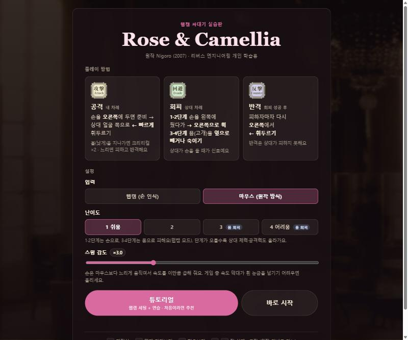
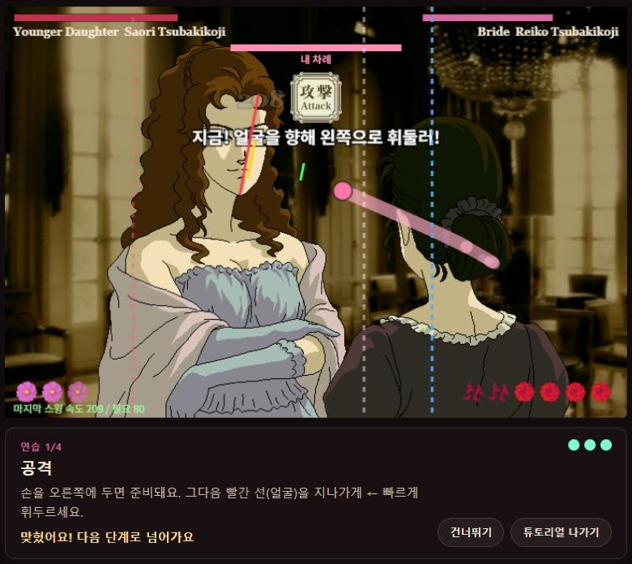
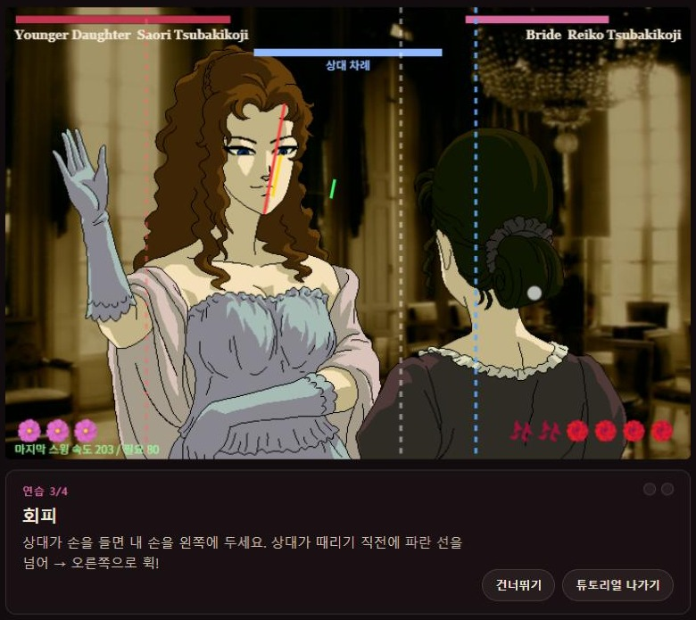
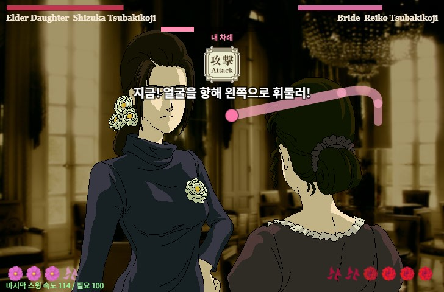
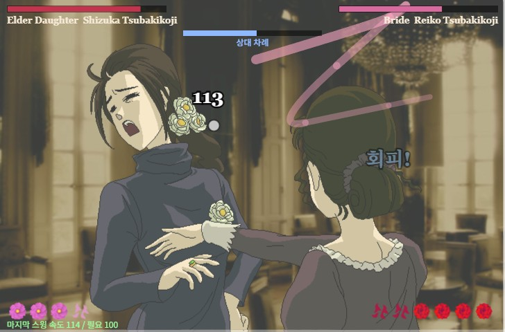
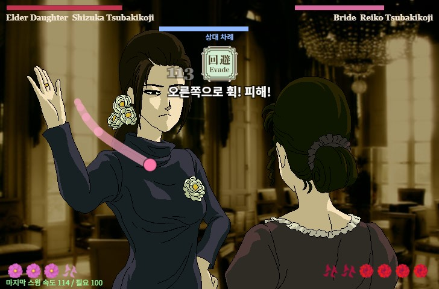
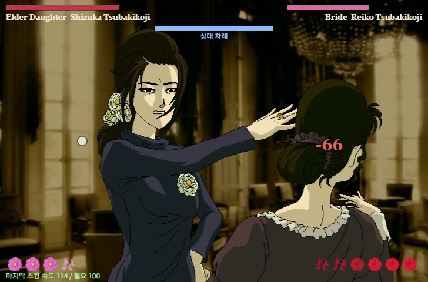

# Reverse-EG — Rose & Camellia 웹캠판 (리버스 엔지니어링 실습)

Nigoro의 플래시 게임 *Rose & Camellia* (2007, `rosecamelliaEng.swf`)를 디컴파일해서
게임 로직과 에셋을 복원하고, 웹캠 손 인식(MediaPipe)으로 직접 싸대기를 휘두르는 웹 게임으로 옮긴 개인 학습용 프로젝트.

## 웹에서 플레이

**[reverse-eg-slap.vercel.app](https://reverse-eg-slap.vercel.app)**

> 원작 에셋은 저작권물이라 `downloads/`, `assets-original/`, `public/assets-original/`는 `.gitignore` 처리되어 GitHub 저장소에는 포함되지 않음.

## 스크린샷

### 타이틀 · 설정



### 튜토리얼

| 연습 1 — 공격 | 연습 3 — 회피 |
|---|---|
|  |  |
| 빨간 선(얼굴)을 지나가게 ← 빠르게 휘두르기 | 상대가 손을 들면 파란 선을 넘어 → 오른쪽으로 휙 |

### 게임플레이

| 내 차례 — 공격 준비 | 싸대기 명중 |
|---|---|
|  |  |
| **상대 차례 — 회피 신호** | **회피 실패 시 반격당함** |
|  |  |

## 실행

```bash
npm install
npm run assets   # assets-original/ → public/assets-original/ (+ manifest.json)
npm run dev      # http://localhost:5173  (?input=mouse 마우스 모드, ?debug 판정선 표시)
```

### 배포 (Vercel)

프로덕션 사이트는 [reverse-eg-slap.vercel.app](https://reverse-eg-slap.vercel.app)에서 공개 중.
로그인이 필요한 비공개 preview 배포가 필요할 때는 아래 명령을 사용:

```bash
npx vercel login
npm run deploy:private
```

- `deploy:private`는 빌드 결과(`dist/`)만 **preview** 배포로 올림
- preview URL은 Vercel Authentication으로 보호되며, 스크립트가 공개 상태로 감지하면 해당 배포를 바로 삭제함

`assets-original/`이 없으면 먼저 추출:

```bash
java -jar tools/ffdec/ffdec-cli.jar -format shape:png,sprite:png,frame:png \
  -export script,image,shape,sprite,sound,text,symbolClass,frame,button assets-original downloads/swf/rosecamelliaEng.swf
```

## 리버스 엔지니어링 과정

| 단계 | 도구 | 결과 |
|---|---|---|
| 에셋/스크립트 추출 | JPEXS FFDec 26.3 (CLI) | 이미지 86, 스프라이트 97, 사운드 29, AS2 스크립트 150 |
| 난독화 해제 | `re/resolve_constants.py` | AS2가 control-flow flattening + 상수풀 참조(`§§constant(N)`)로 난독화됨 → P-code의 `ConstantPool`로 이름 복원 |
| 로직 분석 | `assets-original/scripts-resolved/Game_system.as` | 데미지 = 마지막 프레임 마우스 이동거리(×2 크리티컬), 적별 스탯(`ATask.inidata`) |
| 화면 배치 | `re/swf_layout.py` (swf2xml), `re/locate_sprite.py` | PlaceObject 행렬로 모든 포즈/멍 오버레이의 스테이지 좌표 계산 |
| 에셋 빌드 | `re/build_assets.py` | 웹에서 쓸 이미지/사운드 + `manifest.json` |

재밌는 발견: 출시 빌드에 `debug = true`가 남아 있어서 숫자키 1~5로 적 선택 + 무적이 됨 (웹판에도 그대로 이식).

## 코드 구조

- `src/game.ts` — `gameMainProg` 상태머신 이식 (상태 번호 원본과 동일). 버튼 클릭 대신 손 위치로 공격/회피/반격 준비
- `src/tutorial.ts` — 튜토리얼: 웹캠 세팅(손 인식 → 범위 → 스윙 3번으로 감도 자동 보정) 후 공격/크리티컬/회피/반격 연습
- `src/stats.ts` — 적 5명 스탯 + 판정선 좌표
- `src/geometry.ts` — `Sub.lineCrossPoint` 이식
- `src/hand.ts` — MediaPipe 손바닥 중심 → 스테이지 좌표, 프레임당 이동거리(원본 단위)로 속도 계산
  + 얼굴 인식(BlazeFace): 난이도 3·4는 손 대신 몸(고개)을 옆으로 빼거나 숙여서 회피 (평소 머리 위치 대비 얼굴 너비 단위로 판정)
- `src/render.ts` — 캔버스 렌더링 (728×480, 원본 해상도)
